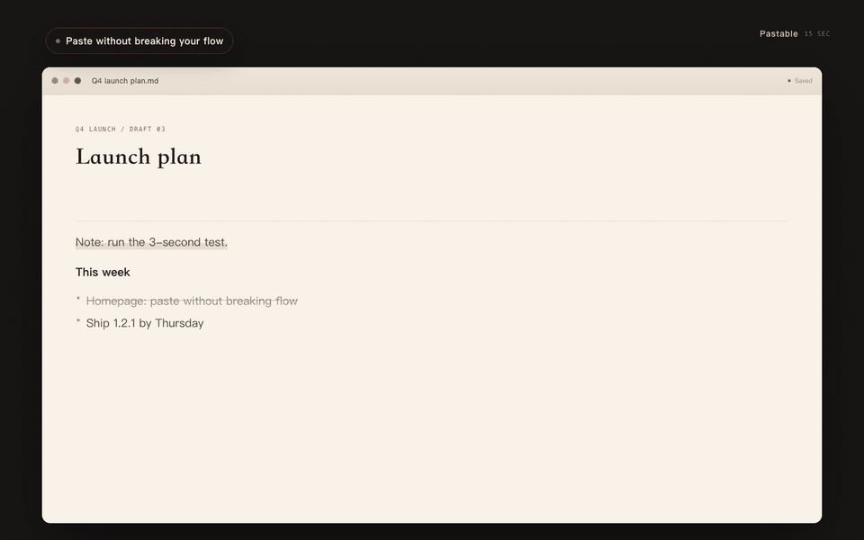

<div align="center">
  
  <h1>Pastable</h1>
  <p><strong>Paste without breaking your flow.</strong></p>
  <p>A full-width clipboard shelf for macOS · never steals keyboard focus · local-first</p>

  <p>
    <a href="https://apps.apple.com/app/id6828470287">
      <picture>
        <source media="(prefers-color-scheme: dark)" srcset="./docs/assets/site/badge/appstore-en-us-white.svg">
        
      </picture>
    </a>
  </p>

  <p>
    
    
    
    
  </p>

  <p>
    <a href="./README.md">简体中文</a> ·
    <a href="./README.en.md">English</a>
  </p>
</div>

<p align="center">
  
  <br>
  <sub>15 seconds: summon → choose → paste, with keyboard focus still in your document.</sub>
</p>

## Download

### Everyone: Mac App Store (recommended)

<p>
  <a href="https://apps.apple.com/app/id6828470287">
    <picture>
      <source media="(prefers-color-scheme: dark)" srcset="./docs/assets/site/badge/appstore-en-us-white.svg">
      
    </picture>
  </a>
</p>

- **$1.99 one-time purchase** — no subscription, no IAP, no account
- One-click install, automatic updates, App Sandbox
- Optional iCloud sync through your own private CloudKit database
- Requires macOS 15.5 or later

### Developers: source / GitHub Releases (free)

- **Source:** <https://github.com/QiuZHsGitHub/Pastable>; clone and build with Xcode, see Development below.
- **Release DMG:** <https://github.com/QiuZHsGitHub/Pastable/releases/latest>, ad-hoc signed and not notarized. On first launch, allow it in **System Settings → Privacy & Security → Open Anyway**. **iCloud sync is not available** in this build.
- This channel is for people who want to audit, modify, or rebuild the code. It is not a free substitute for the App Store version: the App Store build is the one that gets automatic updates, iCloud sync, and a normal first-launch experience.

> Positioning: **App Store = the complete build for normal users**; **GitHub = developer builds**. The badge at the top of this README points to the App Store on purpose; the source/release route lives here, where developers can find it.

## Table of Contents

- [Download](#download)
- [Highlights](#highlights)
- [Usage](#usage)
- [Settings](#settings)
- [Development](#development)
- [Design & Theme](#design--theme)
- [Project Structure](#project-structure)
- [Inspirations](#inspirations)
- [License](#license)

## Highlights

- **Keyboard focus stays put**: opening the shelf does not take focus from the current app. Keep typing in your document, then choose a card to paste back — that is what "without breaking your flow" actually means.
- **Keyboard navigation**: arrows / Enter / Esc / ⌘1–9 / ⌘⌫ work while the shelf is open. The keyboard monitor only runs while the shelf is visible, consumes only those navigation keys, and passes every other key through without recording it. This needs both Accessibility and Input Monitoring. Without Input Monitoring, mouse interaction and document typing still work normally.
- **Full-width bottom shelf**: the global shortcut (default `Cmd + Shift + V`) opens a full-width shelf flush with the bottom of the screen, over any app.
- **Dock layering**: the shelf stays above the Dock, so cards are never covered and the panel does not float awkwardly.
- **One-click paste**: click a card or press `Enter`; the content is written back to the clipboard and pasted into the current app, with the caret still in place.
- **Search and classification**: exact or fuzzy search, multi-token matching, source app and match highlighting; text, code, links, images, and files are recognised automatically.
- **History management**: retention window, capacity limit, and manual cleanup; when a legacy store exceeds the limit, Pastable asks before deleting anything.
- **Optional iCloud sync**: sync through a private CloudKit database in your own iCloud account.
- **Shortcuts**: configurable global hotkey; `Cmd + 1…9` / `Fn + 1…9` for quick paste.

## Usage

- **Toggle panel**: your configured shortcut (default `Cmd + Shift + V`); it never steals keyboard focus
- **Focus search**: `Cmd + Shift + F`
- **Quick paste**: click a card, or select one and press `Enter`
- **Select a card**: `←` / `→` while the search field is empty
- **Number shortcuts**: `Cmd + 1…9` or `Fn + 1…9` to paste the Nth item
- **Delete card**: hover it (or select it) and press `Cmd + Delete`
- **Close panel**: `Esc`, the global shortcut again, or a click anywhere outside the panel
- **Space switches won't dismiss it**: the shelf stays in place when you switch to another Space or go fullscreen (a click outside still closes it)

## Settings

- Search mode: Exact / Fuzzy (titles and full content; all tokens must match)
- Auto paste (requires Accessibility permission; a clear prompt is shown and the app falls back to copy-only)
- Remove formatting, sound feedback
- Save types: Text / Image / File
- History limit and retention duration (enforced; a one-time prompt offers Clean Up / Keep Everything / Later)
- iCloud sync (off by default; see [docs/icloud.md](docs/icloud.md))
- Launch at login, storage usage statistics
- **Rating entry**: Settings → About → Rate on the Mac App Store

> The review request is never shown at launch. The first successful paste marks the moment; the system prompt is then presented on a later panel open. See the "评分策略" section in [docs/appstore/submission-checklist.md](docs/appstore/submission-checklist.md).

> Large TIFF screenshots are converted to PNG in the background, dramatically shrinking the store. Images also get a small pre-rendered thumbnail and display metadata at capture time, so cards never decode the original.

## Development

```bash
swift test    # 237 logic / localization tests, using an in-memory store
./tools/testing/run-tests.sh --smoke --e2e   # full regression + build + smoke + 112 end-to-end checks
xcodebuild -project Pastable.xcodeproj -scheme Pastable \
  -configuration Debug -destination 'platform=macOS' \
  -derivedDataPath /tmp/PastableDerived CODE_SIGNING_ALLOWED=NO build
```

Use `PASTABLE_STORAGE_DIR=/tmp/PastableTest` to redirect the database while debugging.

The end-to-end run opens the real panel and Settings window and needs Accessibility and Screen Recording permission. It uses an isolated bundle id and a temporary store, and restores the system clipboard afterwards. See [`docs/testing/自动化测试方案.md`](docs/testing/自动化测试方案.md).

Follow [`DEPENDENCIES.md`](./DEPENDENCIES.md) to add the Swift Package dependency in Xcode, then open `Pastable.xcodeproj`.

### Regenerate the store screenshots and demo

```bash
node tools/marketing/render.mjs shots   # 2880×1800 App Store screenshots
node tools/marketing/render.mjs demo    # PNG frames for the 15s demo
python3 tools/marketing/make_gif.py     # writes docs/assets/site/demo-{zh,en}.gif (needs Pillow)
```

## Design & Theme

Follows the **macOS system Light / Dark appearance**. Since 2026-10 the theme is **China Trend · Cinnabar**: opaque layered surfaces, solid text tokens, and cinnabar reserved for emphasis.

- Dark: panel `#2C2A29 → #141211`, text `#F6F1EA / #ACA49B / #8E867D`, accent `#E0523B`
- Light: panel `#F5F0E9 → #DDD2C4`, cards `#FFFDFB`, text `#1B1816 / #4A443D / #5C554C`, accent `#C8402E`
- Category colors: Text `#4E8F7C`, Code `#4A7DB2`, Link `#9A72A8`, Media `#C46F88`, Color `#D9824B`

<p align="center">
  
  
</p>

- Figma: [Dark](https://www.figma.com/design/4lqk62cQU0WffNMgUXkGez/Paste?node-id=2006-6) · [Light](https://www.figma.com/design/4lqk62cQU0WffNMgUXkGez/Paste?node-id=2011-11) · [Cinnabar theme](https://www.figma.com/design/4lqk62cQU0WffNMgUXkGez/Paste?node-id=2026-2)
- Tokens and handoff: [docs/theme.md](docs/theme.md), [docs/figma.md](docs/figma.md)
- Theme kit: [design/theme-cinnabar](design/theme-cinnabar/README.md)

## Project Structure

```text
Pastable/
├── Core/          # lifecycle, clipboard monitor, search, theme, review coordinator
├── Models/        # history models and content parsing
├── Persistence/   # SwiftData persistence, dedup, retention
├── UI/            # floating shelf, cards, settings views
└── Extensions/    # shared extensions and pasteboard types
Tests/             # SwiftPM unit tests
tools/marketing/   # App Store screenshots and 15s demo generator
```

## Inspirations

- Raycast
- Alfred
- Pastebot
- Maccy
- Clipy

## License

This project is open-sourced under the [MIT License](./LICENSE).
