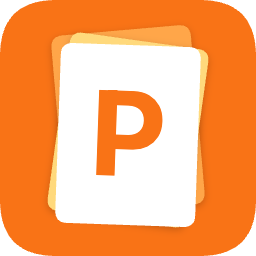
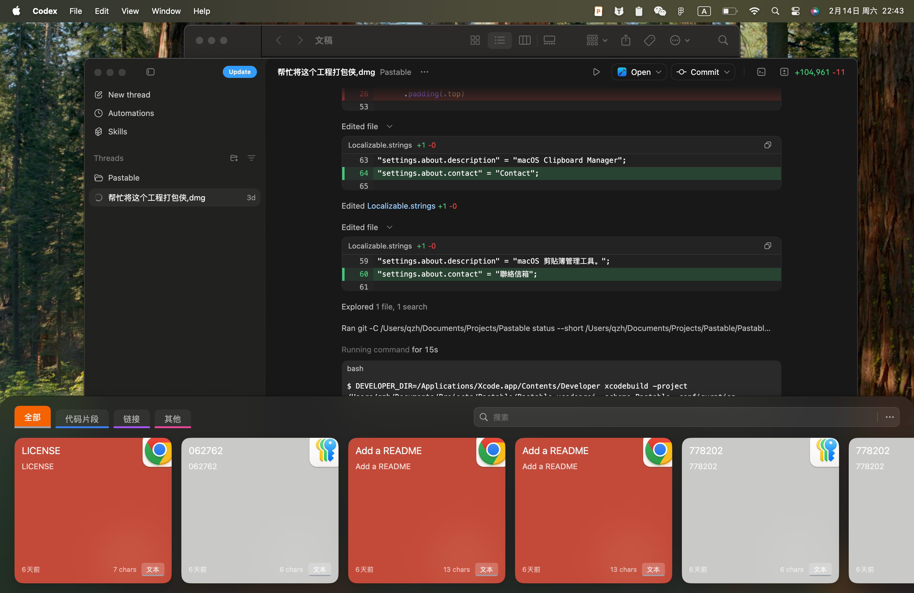
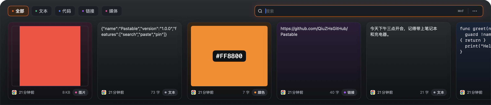
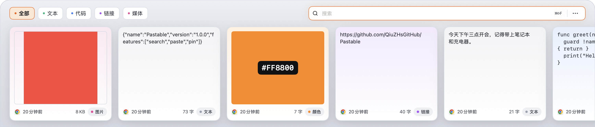

<div align="center">
  
  <h1>Pastable</h1>
  <p><strong>轻量、快速的 macOS 剪贴板管理器</strong></p>
  <p>专注「随叫随到的浮层」与「更聪明的搜索」，让复制内容回找和粘贴更高效。</p>
  <p>
    <a href="./README.md">简体中文</a> ·
    <a href="./README.en.md">English</a>
  </p>
  <p>
    
    
    
    <a href="https://github.com/QiuZHsGitHub/Pastable/releases/latest"></a>
    
  </p>
</div>

<p align="center">
  
</p>

## 目录

- [主题](#主题)
- [功能亮点](#功能亮点)
- [快速开始](#快速开始)
- [下载安装](#下载安装)
- [使用方式](#使用方式)
- [设置项](#设置项)
- [项目结构](#项目结构)
- [灵感来源](#灵感来源)
- [许可证](#许可证)

## Figma 设计稿

- Dark 设计空间：[Pastable / UI 2026](https://www.figma.com/design/4lqk62cQU0WffNMgUXkGez/Paste?node-id=2006-6)
- Light 设计空间：[Pastable / UI 2026 · Light](https://www.figma.com/design/4lqk62cQU0WffNMgUXkGez/Paste?node-id=2011-11)
- 说明与 Token 对照：[docs/figma.md](docs/figma.md) · [docs/theme.md](docs/theme.md)
- 面板单帧：[Dark](https://www.figma.com/design/4lqk62cQU0WffNMgUXkGez/Paste?node-id=2006-15) · [Light](https://www.figma.com/design/4lqk62cQU0WffNMgUXkGez/Paste?node-id=2011-24)

## 主题

默认跟随 **macOS 系统 Light / Dark**，不强制深色，也没有额外的主题选择器。面板为不透明分层玻璃质感，文字全部使用实色 Token（不再用白色/黑色 alpha）：

- 深色：面板 `#2B2C31 → #151619`，文字 `#F3F4F6 / #A8ADB6 / #8B9099`
- 浅色：面板 `#EDF0F4 → #D7DCE4`，卡片 `#FFFFFF`，文字 `#101216 / #414750 / #515861`
- 卡片：分类色与卡片底色混合，Dark 18%/24%，Light 12%/20%

<p align="center">
  
  
</p>

完整 Token 与 Figma 对照见 [docs/theme.md](docs/theme.md)。

## 功能亮点

- **全屏底部浮层**：一键呼出最近复制历史，不打断当前工作流
- **搜索体验优化**：支持精确匹配和模糊匹配，快速定位目标内容
- **内容类型识别**：自动识别文本、代码、链接、图片、文件
- **一键回贴**：选中卡片即可写回剪贴板并自动执行粘贴
- **历史管理**：支持保留时长、容量限制与手动清空
- **快捷键体系**：支持自定义全局唤起快捷键

<p align="center">
  
</p>

## 快速开始

### 1) 克隆项目

```bash
git clone https://github.com/QiuZHsGitHub/Pastable.git
cd Pastable
```

### 2) 安装依赖

按 `./DEPENDENCIES.md` 在 Xcode 中添加 Swift Package 依赖。

### 3) 运行项目

1. 打开 `./Pastable.xcodeproj`
2. 选择 `Pastable` scheme
3. 选择 macOS 目标后运行

## 下载安装

- 最新版本：<https://github.com/QiuZHsGitHub/Pastable/releases/latest>
- 进入 Release 页面后下载 `.dmg` 安装包即可

## 使用方式

- **呼出面板**：使用你在设置中配置的快捷键（默认 `Cmd + Shift + V`），打开后自动聚焦搜索框
- **聚焦搜索**：`Cmd + Shift + F`
- **快速粘贴**：点击卡片，或按 `Enter` 粘贴选中项
- **选择卡片**：搜索框为空时用 `←` / `→` 选择
- **数字快贴**：`Cmd + 1…9` 或 `Fn + 1…9` 直接粘贴第 N 项
- **删除卡片**：悬停在卡片上（或先选中）后按 `Cmd + Delete`
- **关闭面板**：`Esc` 或再次按全局快捷键

## 设置项

- 搜索模式：精确 / 模糊（搜索标题与完整内容，多关键词需同时匹配）
- 自动粘贴（需要辅助功能权限，未授权时会给出提示并退回仅复制）
- 去除格式
- 音效反馈
- 保存类型：文本 / 图片 / 文件（关闭的类型不会再被采集）
- 历史上限与保留时间（会真正执行；首次发现有历史超过限制时会询问「清理 / 全部保留 / 稍后」）
- 登录时启动、存储占用统计

> 截图/复制得到的大尺寸 TIFF 会在后台自动转成 PNG，显著减小数据库体积。

## 开发与测试

```bash
swift test    # 39 个逻辑测试，使用内存数据库
xcodebuild -project Pastable.xcodeproj -scheme Pastable \
  -configuration Debug -destination 'platform=macOS' \
  -derivedDataPath /tmp/PastableDerived CODE_SIGNING_ALLOWED=NO build
```

调试时可用 `PASTABLE_STORAGE_DIR=/tmp/PastableTest` 把数据库重定向到临时目录。

## 项目结构

```text
Pastable/
├── Core/          # 应用生命周期、剪贴板监听、搜索、主题
├── Models/        # 历史数据模型与内容解析
├── Persistence/   # SwiftData 持久化、去重、容量维护
├── UI/            # 浮层、卡片列表、设置页
└── Extensions/    # 通用扩展与 Pasteboard 类型定义
Tests/             # SwiftPM 单元测试
```

## 灵感来源

- Raycast
- Alfred
- Pastebot
- Maccy
- Clipy

## 许可证

本项目基于 [MIT License](./LICENSE) 开源。
