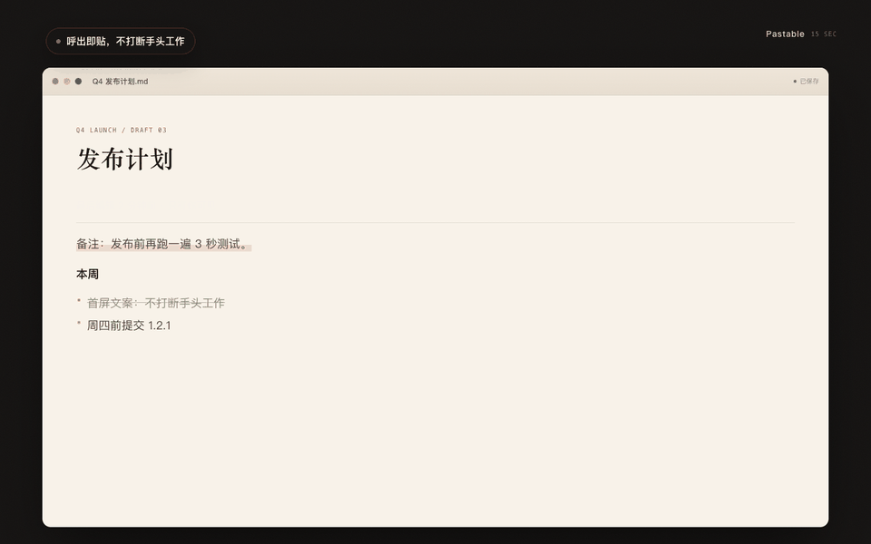

<div align="center">
  
  <h1>Pastable</h1>
  <p><strong>呼出即贴，不打断手头工作。</strong></p>
  <p>macOS 的全屏底部剪贴板浮层 · 不抢键盘焦点 · 本地优先</p>

  <p>
    <a href="https://apps.apple.com/app/id6828470287">
      <picture>
        <source media="(prefers-color-scheme: dark)" srcset="./docs/assets/site/badge/appstore-zh-cn-white.svg">
        
      </picture>
    </a>
  </p>

  <p>
    
    
    
    
  </p>

  <p>
    <a href="./README.md">简体中文</a> ·
    <a href="./README.en.md">English</a>
  </p>
</div>

<p align="center">
  
  <br>
  <sub>15 秒看懂：呼出 → 选中 → 回贴；键盘焦点始终留在文档里。</sub>
</p>

## 下载

### 普通用户：Mac App Store（推荐）

<p>
  <a href="https://apps.apple.com/app/id6828470287">
    <picture>
      <source media="(prefers-color-scheme: dark)" srcset="./docs/assets/site/badge/appstore-zh-cn-white.svg">
      
    </picture>
  </a>
</p>

- **¥12 一次买断**，无订阅、无内购、无账号
- 一键安装、自动更新、沙盒运行
- 可选 iCloud 同步：使用你自己的私有 CloudKit 数据库
- 要求 macOS 15.5 及以上

### 开发者：GitHub 源码 / Release（免费）

- **源码**：clone 后自行用 Xcode 编译，见下方「开发与测试」。
- **Release DMG**：免证书（ad-hoc）签名、未公证；首次打开需在「系统设置 → 隐私与安全性」点「仍要打开」。**不含 iCloud 同步**。
- 这一渠道面向想审计、修改或二次构建代码的人。它不是 App Store 版的免费替代品：普通用户从 App Store 安装，才能获得自动更新与 iCloud 同步，也不用处理未公证应用的首次启动提示。

> 两边的定位：**App Store = 普通用户的完整版**；**GitHub = 开发者构建**。README 顶部只放 App Store 徽章，源码入口放在这里，避免把付费用户引到需要自己编译的页面。

## 目录

- [下载](#下载)
- [功能亮点](#功能亮点)
- [使用方式](#使用方式)
- [设置项](#设置项)
- [开发与测试](#开发与测试)
- [设计与主题](#设计与主题)
- [项目结构](#项目结构)
- [灵感来源](#灵感来源)
- [许可证](#许可证)

## 功能亮点

- **不抢键盘焦点**：面板打开时，键盘焦点仍留在当前 App。你可以在文档里继续打字，再选一张卡片回贴——这是「不打断」真正的含义。
- **全屏底部浮层**：全局快捷键（默认 `Cmd + Shift + V`）在任意 App 上方唤出全屏宽、贴屏幕底部的浮层，即用即走。
- **Dock 层级**：面板打开时保持在 Dock 之上，卡片不会被 Dock 盖住，也不会悬空。
- **一键回贴**：点击卡片或按 `Enter`，内容写回剪贴板并自动粘贴到当前 App；关闭面板后光标仍在原处。
- **搜索与分类**：支持精确 / 模糊搜索、多关键词匹配、来源应用与命中高亮；文本、代码、链接、图片、文件自动识别。
- **历史管理**：保留时长、容量上限、手动清空；首次超出限制时会先询问「清理 / 全部保留 / 稍后」。
- **可选 iCloud 同步**：通过你自己 iCloud 账户的私有 CloudKit 数据库，在登录同一 Apple ID 的 Mac 之间同步。
- **快捷键体系**：全局唤起键可自定义；`Cmd + 1…9` / `Fn + 1…9` 数字快贴。

## 使用方式

- **呼出面板**：使用你在设置中配置的快捷键（默认 `Cmd + Shift + V`）；打开后不会抢键盘焦点，输入仍归当前 App
- **聚焦搜索**：`Cmd + Shift + F`
- **快速粘贴**：点击卡片，或按 `Enter` 粘贴选中项
- **选择卡片**：搜索框为空时用 `←` / `→` 选择
- **数字快贴**：`Cmd + 1…9` 或 `Fn + 1…9` 直接粘贴第 N 项
- **删除卡片**：悬停在卡片上（或先选中）后按 `Cmd + Delete`
- **关闭面板**：`Esc`、再次按全局快捷键，或点击面板外任意位置
- **切 Space 不消失**：切换桌面空间 / 进入全屏不会让面板自动关闭（点击面板外仍会收起）

## 设置项

- 搜索模式：精确 / 模糊（搜索标题与完整内容，多关键词需同时匹配）
- 自动粘贴（需要辅助功能权限；未授权时会提示并退回仅复制）
- 去除格式、音效反馈
- 保存类型：文本 / 图片 / 文件（关闭的类型不再采集）
- 历史上限与保留时间（会真正执行；超出限制时会先询问）
- iCloud 同步（默认关闭；详见 [docs/icloud.md](docs/icloud.md)）
- 登录时启动、存储占用统计
- **评分入口**：设置 → 关于 → 在 Mac App Store 评分

> 评分请求不会在启动时弹出：第一次成功粘贴后才会标记，并在下一次打开面板时由系统评分弹窗询问。详见 [docs/appstore/submission-checklist.md](docs/appstore/submission-checklist.md) 的「评分策略」。

> 大尺寸 TIFF 截图会在后台转成 PNG，显著减小数据库体积；图片入库时预生成缩略图与展示元数据，卡片渲染无需解码原图。

## 开发与测试

```bash
swift test    # 66 个逻辑 / 本地化测试，使用内存数据库
xcodebuild -project Pastable.xcodeproj -scheme Pastable \
  -configuration Debug -destination 'platform=macOS' \
  -derivedDataPath /tmp/PastableDerived CODE_SIGNING_ALLOWED=NO build
```

调试时可用 `PASTABLE_STORAGE_DIR=/tmp/PastableTest` 把数据库重定向到临时目录。

首次编译前请按 [`DEPENDENCIES.md`](./DEPENDENCIES.md) 在 Xcode 中添加 Swift Package 依赖，然后打开 `Pastable.xcodeproj` 运行。

### 生成商店截图与官网演示

```bash
node tools/marketing/render.mjs shots   # 2880×1800 App Store 截图
node tools/marketing/render.mjs demo    # 15 秒演示的逐帧 PNG
python3 tools/marketing/make_gif.py     # 合成 docs/assets/site/demo-{zh,en}.gif
```

## 设计与主题

默认跟随 **macOS 系统 Light / Dark**。2026-10 起使用「中国潮色 · 朱砂」：面板为不透明分层，文字全部使用实色 Token，朱砂只做强调色。

- 深色：面板 `#2C2A29 → #141211`，文字 `#F6F1EA / #ACA49B / #8E867D`，主色 `#E0523B`
- 浅色：面板 `#F5F0E9 → #DDD2C4`，卡片 `#FFFDFB`，文字 `#1B1816 / #4A443D / #5C554C`，主色 `#C8402E`
- 分类色：晓山青 `#4E8F7C`、青花蓝 `#4A7DB2`、木槿紫 `#9A72A8`、黛子粉 `#C46F88`、落暖橘 `#D9824B`

<p align="center">
  
  
</p>

- Figma：[Dark](https://www.figma.com/design/4lqk62cQU0WffNMgUXkGez/Paste?node-id=2006-6) · [Light](https://www.figma.com/design/4lqk62cQU0WffNMgUXkGez/Paste?node-id=2011-11) · [朱砂主题](https://www.figma.com/design/4lqk62cQU0WffNMgUXkGez/Paste?node-id=2026-2)
- Token 与对照：[docs/theme.md](docs/theme.md)、[docs/figma.md](docs/figma.md)
- 主题稿与生成器：[design/theme-cinnabar](design/theme-cinnabar/README.md)

## 项目结构

```text
Pastable/
├── Core/          # 应用生命周期、剪贴板监听、搜索、主题、评分协调
├── Models/        # 历史数据模型与内容解析
├── Persistence/   # SwiftData 持久化、去重、容量维护
├── UI/            # 浮层、卡片列表、设置页
└── Extensions/    # 通用扩展与 Pasteboard 类型定义
Tests/             # SwiftPM 单元测试
tools/marketing/   # App Store 截图与 15 秒演示生成器
```

## 灵感来源

- Raycast
- Alfred
- Pastebot
- Maccy
- Clipy

## 许可证

本项目基于 [MIT License](./LICENSE) 开源。
