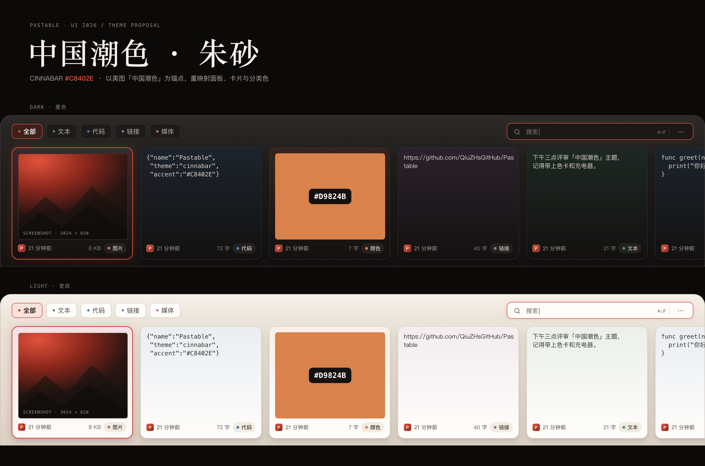
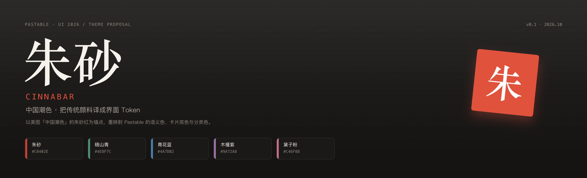
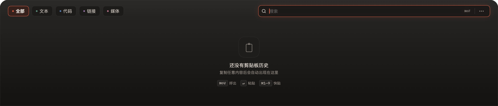

# Pastable · 中国潮色（朱砂）

基于美图 2021 年「中国潮色」滤镜系列做的一版主题提案。原系列有 13 个颜色：朱砂红、藤枝黄、墨油绿、青花蓝、烟雨灰、暮檐褐、黛子粉、落暖橘、木槿紫、晓山青、水墨黑、素晖银、圣鎏金（[中国日报报道](http://chuangxin.chinadaily.com.cn/a/202112/29/WS61cbc6f3a3107be4979ff8f4.html)）。

这一版取 **朱砂红** 做主色，晓山青 / 青花蓝 / 木槿紫 / 黛子粉 / 落暖橘做分类色，保留 Pastable 原有的「跟随 macOS、实色文字、不透明分层」规则，只重映射语义 Token。



## 已生成到 Figma

页面已经写进 Paste 文件，未改动原有页面：

- **页面**：[Pastable / UI 2026 · 中国潮色](https://www.figma.com/design/4lqk62cQU0WffNMgUXkGez/Paste?node-id=2026-2)（`2026:2`）
- [00 Cover](https://www.figma.com/design/4lqk62cQU0WffNMgUXkGez/Paste?node-id=2028-498)
- [01 Panel · Dark](https://www.figma.com/design/4lqk62cQU0WffNMgUXkGez/Paste?node-id=2028-528)
- [01 Panel · Light](https://www.figma.com/design/4lqk62cQU0WffNMgUXkGez/Paste?node-id=2028-628)
- [03 Tokens](https://www.figma.com/design/4lqk62cQU0WffNMgUXkGez/Paste?node-id=2028-727)
- [04 Handoff](https://www.figma.com/design/4lqk62cQU0WffNMgUXkGez/Paste?node-id=2028-866)



> 2026-10：搜索框由 800pt 收窄到 400pt（插件里的 `SEARCH_W`，与 App 的
> `HeaderView.searchBarWidth` 一致）。仓库内的 `preview/panel-*.png`、`compare.png`
> 已重新生成；Figma 云文件需要重跑一次本地插件才会更新，`preview/figma-panel-*.png`
> 也仍是收窄前的导出。

## 交付物

| 文件 | 用途 |
|---|---|
| [`tokens.json`](./tokens.json) | W3C DTCG 风格 Token，含 Dark / Light 两套语义值 |
| [`figma-plugin/manifest.json`](./figma-plugin/manifest.json) | Figma 本地插件清单 |
| [`figma-plugin/code.js`](./figma-plugin/code.js) | 生成页面的插件代码（由模板 + Token 注入生成） |
| [`preview/panel-dark.png`](./preview/panel-dark.png) | 1512 × 325 面板预览（Dark，@2x） |
| [`preview/panel-light.png`](./preview/panel-light.png) | 1512 × 325 面板预览（Light，@2x） |
| [`preview/figma-cover.png`](./preview/figma-cover.png) | Figma 实际导出的封面 |
| [`preview/figma-panel-dark.png`](./preview/figma-panel-dark.png) | Figma 实际导出的 Dark 面板 |
| [`preview/figma-panel-light.png`](./preview/figma-panel-light.png) | Figma 实际导出的 Light 面板 |
| [`preview/figma-tokens.png`](./preview/figma-tokens.png) | Figma 实际导出的 Token 板 |
| [`preview/figma-handoff.png`](./preview/figma-handoff.png) | Figma 实际导出的 Handoff |
| [`preview/app-panel-dark.png`](./preview/app-panel-dark.png) | 实际 App 深色空状态（2026-10） |

## 导入 Figma

1. 打开 Figma 桌面端，进入 **Paste** 文件（`4lqk62cQU0WffNMgUXkGez`）。
2. 菜单 → **Plugins → Development → Import plugin from manifest…**
3. 选择 `design/theme-cinnabar/figma-plugin/manifest.json`。
4. 运行 **Pastable · 中国潮色**。
5. 插件会复用 `Pastable / UI 2026 · 中国潮色` 页面；如果不存在则新建，然后生成 5 个 Frame。

插件只清理自己生成过的 `潮色 /`、`Label /`、`__` 节点，保留你后来手动加的内容；现有的 `2006 / 2011` 页面不会被改动。

## 页面结构

| Frame | 内容 |
|---|---|
| `潮色 / 00 Cover` | 朱砂标题、印章、5 个源色色卡 |
| `潮色 / 01 Panel · Dark` | 1512 × 325 完整面板，6 张卡片，选中态 |
| `潮色 / 01 Panel · Light` | 同一布局的宣纸版 |
| `潮色 / 03 Tokens` | 朱砂色阶、明暗语义色、分类色 |
| `潮色 / 04 Handoff` | 旧值 → 新值对照、落地规则、交付路径 |

插件同时会在文件里创建 19 个本地颜色样式，前缀 `潮色 /`，方便直接吸色。

## Token 速查

| Token | Dark | Light |
|---|---|---|
| Accent | `#E0523B` | `#C8402E` |
| Accent soft（选中 Tab） | `#3B201B` | `#FBE3DC` |
| Panel top / mid / bottom | `#2C2A29 / #252322 / #141211` | `#F5F0E9 / #EBE4DA / #DDD2C4` |
| Panel border | `#3A3634` | `#CFC4B5` |
| Card base | `#131110` | `#FFFDFB` |
| Text primary | `#F6F1EA` | `#1B1816` |
| Text secondary | `#ACA49B` | `#4A443D` |
| Text tertiary | `#8E867D` | `#5C554C` |
| Card tint | 18% / 选中 24% | 12% / 选中 20% |

分类色：Text `#4E8F7C`（晓山青）、Code `#4A7DB2`（青花蓝）、Link `#9A72A8`（木槿紫）、Media `#C46F88`（黛子粉）、Color `#D9824B`（落暖橘）、All `#9AA0A6`（烟雨灰）。

主色在 Dark 提亮到 `#E0523B`，是为了在 `#2C2A29` 面板上保持 ≥ 3:1 的可辨识度；Light 用 `#C8402E`，在白底上对比度 4.9:1。文字仍全部实色，alpha 只用于阴影、聚焦光晕和选中 glow。

## 重新生成

Token 是唯一数据源。修改 `tokens.json` 后：

```bash
node design/theme-cinnabar/build.mjs   # 重新生成 preview/index.html 和 code.js
node design/theme-cinnabar/mock-run.mjs # 用 mock Figma API 跑一遍，检查运行时错误
```

前提：本机有 Node 18+。预览图用 Chrome headless 渲染：

```bash
"/Applications/Google Chrome.app/Contents/MacOS/Google Chrome" \
  --headless=new --hide-scrollbars --force-device-scale-factor=2 \
  --window-size=1512,325 --default-background-color=00000000 \
  --screenshot=design/theme-cinnabar/preview/panel-dark.png \
  "file://$PWD/design/theme-cinnabar/preview/index.html?mode=dark"
```

## 代码落地

已实现到 App 源码（2026-10）：

- [`Pastable/Core/ThemeManager.swift`](../../Pastable/Core/ThemeManager.swift)：`AppTheme` 的面板、文字、Tab、卡片 Token 换成朱砂，新增 `accent` / `accentGlow`。
- [`Pastable/Extensions/Color+Extensions.swift`](../../Pastable/Extensions/Color+Extensions.swift)：新增 `AppPalette` 与 `pastableAccent`，分类色集中为 `Color.category*`。
- [`Pastable/UI/Components/CategoryFilter.swift`](../../Pastable/UI/Components/CategoryFilter.swift)：分类色改用新五色。
- [`Pastable/UI/Components/CardCell.swift`](../../Pastable/UI/Components/CardCell.swift)：`tintHex` 与选中描边/glow 改用朱砂 Token。
- [`Pastable/UI/Components/SearchBar.swift`](../../Pastable/UI/Components/SearchBar.swift)：聚焦边框、glow 与文本光标改用朱砂。

验证：

```bash
swift test
xcodebuild -project Pastable.xcodeproj -scheme Pastable \
  -configuration Debug -destination 'platform=macOS' \
  -derivedDataPath /tmp/PastableDerived CODE_SIGNING_ALLOWED=NO build
```

Xcode 构建已通过；实际启动后深色面板、Tab、搜索聚焦环和空状态均已确认。



## 已知限制

- 这是本地开发插件，manifest 里的 `id` 是固定值；如果 Figma 拒绝导入，按官方流程新建一个本地插件，把 `code.js` 内容贴进去即可。
- 插件生成的是静态稿，不包含 Figma Variables；`tokens.json` 可以直接给 Tokens Studio 或后续脚本用。
- 字体优先 `PingFang SC` / `SF Pro` / `Songti SC`，系统缺字体时自动回退到 `Inter`。
