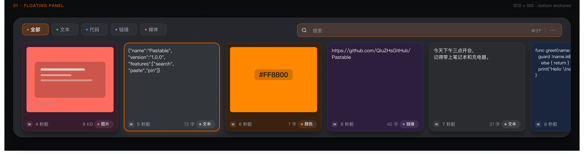
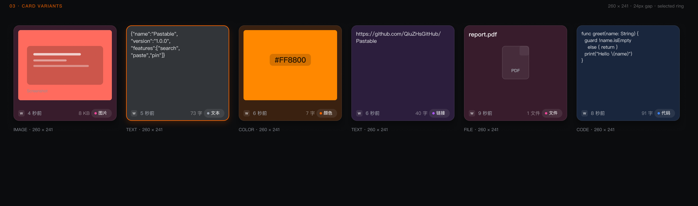
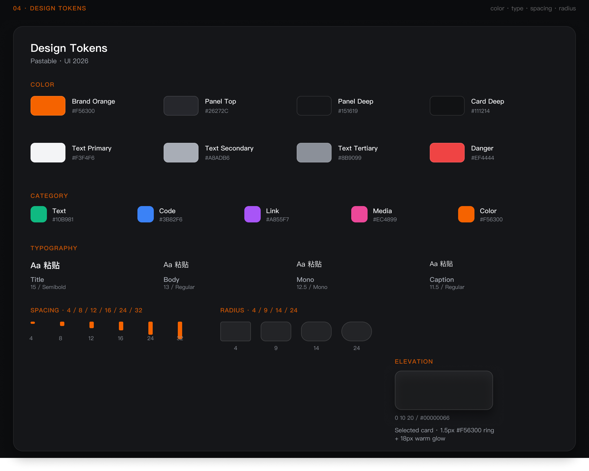
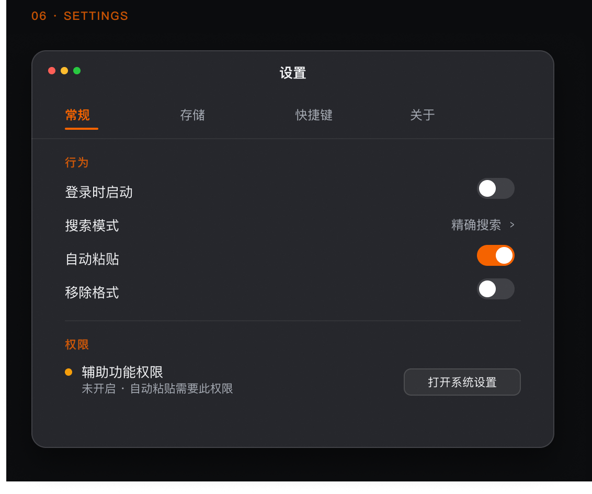
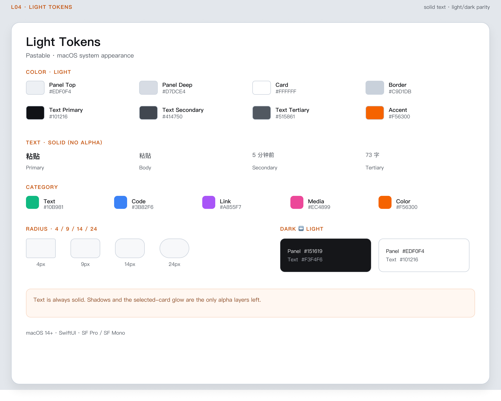

# Figma UI Space · Pastable / UI 2026

> 当前 App 使用「中国潮色 · 朱砂」主题（见文末）。本文前文的 `2006 / 2011` 页面仍是旧版橙色基线，保留作为历史对照。

Figma 文件（Paste）：

- **Dark 页面入口**：<https://www.figma.com/design/4lqk62cQU0WffNMgUXkGez/Paste?node-id=2006-6>
- **Dark 单帧（Floating Panel）**：<https://www.figma.com/design/4lqk62cQU0WffNMgUXkGez/Paste?node-id=2006-15>
- **Light 页面入口**：<https://www.figma.com/design/4lqk62cQU0WffNMgUXkGez/Paste?node-id=2011-11>
- **Light 单帧（Floating Panel）**：<https://www.figma.com/design/4lqk62cQU0WffNMgUXkGez/Paste?node-id=2011-24>
- 页面名：`Pastable / UI 2026`（Dark）、`Pastable / UI 2026 · Light`
- 尺寸基线：面板 `1512 × 325`，卡片 `260 × 241`，窗口 `500 × 380`

## 页面结构

| Frame | 内容 |
|---|---|
| 00 · Cover | 标题、版本、橙色 Logo |
| 01 · Floating Panel | 完整面板、5 个分类、搜索框、6 种卡片、选中态 |
| 02 · Empty State | 首次启动空状态、快捷键提示 |
| 03 · Card Variants | Image / Text / Color / Link / File / Code 六种卡片 |
| 04 · Design Tokens | 色彩、字阶、间距、圆角、阴影 |
| 05 · Components | 分类 Tab、搜索框、类型 Badge、键盘提示、Toggle |
| 06 · Settings | 500×380 设置窗口 |
| 07 · Handoff | SwiftUI 文件、行为、Token、可访问性说明 |

Light 页面包含 `L00 · Cover`、`L01 · Panel`、`L02 · Empty`、`L03 · Cards`、`L04 · Tokens`、`L05 · Settings`、`L06 · Handoff`。

## 视觉基线（2006 / 2011 旧版）

- 品牌色：`#F56300`
- 面板 Dark：`#26272C → #151619` 不透明深色渐变；Light：`#EDF0F4 → #D7DCE4`。顶部圆角 24，1px 语义描边 + 顶部高光，无桌面透色
- 卡片：分类色与卡片底色混合，Dark `#111214` 18%/24%，Light `#FFFFFF` 12%/20%；圆角 14
- 选中：`1.5px #F56300` 描边 + 橙色柔光
- 文字：Dark `#F3F4F6` / `#A8ADB6` / `#8B9099`；Light `#101216` / `#414750` / `#515861`（全部实色，无 alpha）
- 分类色：Text `#10B981`、Code `#3B82F6`、Link `#A855F7`、Media `#EC4899`、Color `#FF8800`
- 圆角：Tab/Search `9–10`、卡片 `14`、面板 `24`
- 字号：标题 15 Semibold、正文 13、页脚 11.5、类型 Badge 11

## 图标

- 搜索图标：**Lucide `search`**（ISC License）
- 本地 SVG：[`docs/assets/icons/lucide-search.svg`](./assets/icons/lucide-search.svg)
- App 资源：`Pastable/Assets.xcassets/icon_search.imageset`
- 许可说明：[`docs/assets/icons/README.md`](./assets/icons/README.md)
- Figma 与 SwiftUI 使用同一份几何：24 viewBox、stroke 2、圆角端点

搜索框右侧的 `⌘⇧F` / 分隔线 / `⋯` 现在整体位于输入框内部，右侧保留 10px 内边距，与 App 的 `SearchBar` 一致。

## 与代码的对应

- 卡片：[`CardCell.swift`](../Pastable/UI/Components/CardCell.swift)
- 分类：[`CategoryFilter.swift`](../Pastable/UI/Components/CategoryFilter.swift)
- 搜索：[`SearchBar.swift`](../Pastable/UI/Components/SearchBar.swift)
- 空状态：[`EmptyStateView.swift`](../Pastable/UI/Components/EmptyStateView.swift)
- 设置：[`SettingsView.swift`](../Pastable/UI/Settings/SettingsView.swift)
- 主面板：[`ContentView.swift`](../Pastable/ContentView.swift)

## 预览

### Floating Panel

### Card Variants

### Design Tokens

### Settings

## Light Theme

- Light 页面：[Pastable / UI 2026 · Light](https://www.figma.com/design/4lqk62cQU0WffNMgUXkGez/Paste?node-id=2011-11)
- Light 面板：[LST / 01 Panel](https://www.figma.com/design/4lqk62cQU0WffNMgUXkGez/Paste?node-id=2011-24)
- 系统外观：App 默认跟随 macOS Light / Dark，没有额外的主题选择器。
- 文本 Token 与完整对照见 [docs/theme.md](theme.md)。

## 已知的视觉差异

- **来源图标 / 图片内容**：Figma 用 `w` 小图标与示意截图；App 显示真实 App 图标和真实剪贴板图片。
- **设置窗口**：Figma 是 500×380 的视觉规格；App 使用原生 macOS 标题栏与 TabView。
- **搜索框宽度**：App 固定 400pt（`HeaderView.searchBarWidth`），Figma 插件（`SEARCH_W`）已同步为 400pt。仓库里的 `figma-panel-*.png` 是收窄前的导出（800pt），在 Figma 里重跑插件并重新导出后即与 App 一致。
- 除此之外，面板尺寸、卡片尺寸、分类 Tab、页脚、选中态、空状态与 Token 均按同一套数值实现。

## 说明

卡片底色按内容类型区分：文本卡是中性灰，图片/文件卡是粉色，代码卡是蓝色，链接卡是紫色，颜色卡使用内容自身的 hex。因此当历史里全部是文本时，整排卡片会呈现统一的深灰色——这是与 Figma 一致的设计预期，不是背景色失效。复制一张图片、一个链接、一个颜色或一段代码，就会看到对应的类型色。

Figma 是视觉基线，SwiftUI 实现是最终源。两边卡片背景使用同一套规则：分类色与卡片底色混合后向下渐变；Dark 为 18%（选中 24%），Light 为 12%（选中 20%）。来源 App 图标只出现在页脚，不再影响卡片底色。

## 中国潮色（已实现）

基于美图 2021 年「中国潮色」滤镜系列做的朱砂主题，**已实现到 App 的 Light/Dark Token**，Figma 页面与源码使用同一套色值：

- 页面：[Pastable / UI 2026 · 中国潮色](https://www.figma.com/design/4lqk62cQU0WffNMgUXkGez/Paste?node-id=2026-2)
- 设计说明与 Token：[`design/theme-cinnabar/README.md`](../design/theme-cinnabar/README.md)
- Token 源文件：[`tokens.json`](../design/theme-cinnabar/tokens.json)
- 生成器：[`figma-plugin`](../design/theme-cinnabar/figma-plugin/manifest.json)

页面包含 `00 Cover`、`01 Panel · Dark`、`01 Panel · Light`、`03 Tokens`、`04 Handoff` 五个 Frame。主色朱砂：Dark `#E0523B`、Light `#C8402E`；分类色换成晓山青、青花蓝、木槿紫、黛子粉、落暖橘。

