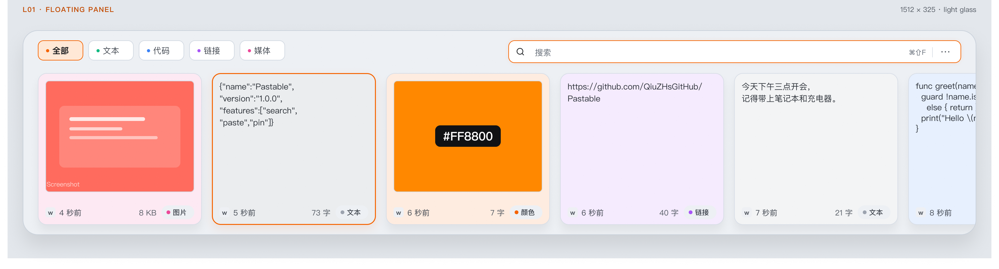

# Theme · macOS Light / Dark

## Design Specification

1. **Purpose**：底部浮层剪贴板工具，用户会在强光办公环境和夜间桌面之间切换；主题必须跟随 macOS，而不是要求用户再选一次。
2. **Aesthetic Direction**：克制的工业玻璃感（industrial/utilitarian glass）。用不透明分层、细描边、顶部高光和轻阴影制造深度；不使用透明度来“假装玻璃”。
3. **Color Palette**：
   - Dark panel `#2B2C31 → #26272C → #151619`
   - Light panel `#EDF0F4 → #E4E8EE → #D7DCE4`
   - Card base dark `#111214` / light `#FFFFFF`
   - Accent `#F56300`
   - Text dark `#F3F4F6 / #A8ADB6 / #8B9099`
   - Text light `#101216 / #414750 / #515861`
4. **Typography**：SF Pro（macOS 原生界面字体）、SF Mono（代码/快捷键）。这是平台约束，替换成 Inter 等字体会破坏 macOS 原生感；品牌色与分类色沿用现有设计系统。分类里的紫色仅作为 Link 类型色，不用于渐变。
5. **Layout Strategy**：保持底部横向排列的卡片带；左侧分类、右侧搜索。Light 不改变布局，只替换语义 Token；面板背景加深，让白色卡片从背景中浮起来。

## macOS Appearance

- App 默认不设置 `NSApp.appearance`，直接跟随 **macOS 系统 Light / Dark**。
- 不再使用 `.preferredColorScheme(.dark)`，也不在设置里放自定义主题选择器。
- 所有组件通过 `@Environment(\.colorScheme)` 读取系统当前外观，`AppTheme` 返回对应的实色 Token。
- 系统切换外观时，面板、设置、更多菜单和空状态一起更新。

## Solid Text Tokens

文本不再使用任何 `white.opacity(...)` / `black.opacity(...)`：

| Token | Dark | Light |
|---|---|---|
| Primary | `#F3F4F6` | `#101216` |
| Body | `#D9DCE1` | `#2B3037` |
| Secondary | `#A8ADB6` | `#414750` |
| Tertiary | `#8B9099` | `#515861` |
| Placeholder | `#7E838C` | `#656D78` |

阴影、搜索聚焦光晕、选中卡片的橙色 glow 仍使用 alpha——它们不是文字颜色，透明度在这里是必要的深度信息。

## Surfaces

| Token | Dark | Light |
|---|---|---|
| Panel top / mid / bottom | `#2B2C31` / `#26272C` / `#151619` | `#EDF0F4` / `#E4E8EE` / `#D7DCE4` |
| Panel border | `#363941` | `#C9D1DB` |
| Card base | `#111214` | `#FFFFFF` |
| Card border | `#2D3036` | `#D8DEE7` |
| Search background | `#1A1C21` | `#FFFFFF` |
| Tab background | `#1D1F24` | `#FFFFFF` |
| Selected tab | `#3A2418` | `#FFE8D6` |
| Type pill | `#23252A` | `#EDF0F4` |

卡片底色使用分类色与卡片底色的混合：

- Dark：普通 `18%`，选中 `24%`，底色 `#111214`
- Light：普通 `12%`，选中 `20%`，底色 `#FFFFFF`

分类色：Text `#10B981`、Code `#3B82F6`、Link `#A855F7`、Media `#EC4899`、Color 使用内容自身 hex。

## Preview

| Dark | Light |
|---|---|
|  |  |

## Figma

- Light page：[Pastable / UI 2026 · Light](https://www.figma.com/design/4lqk62cQU0WffNMgUXkGez/Paste?node-id=2011-11)
- Light panel：[LST / 01 Panel](https://www.figma.com/design/4lqk62cQU0WffNMgUXkGez/Paste?node-id=2011-24)
- Dark page：[Pastable / UI 2026](https://www.figma.com/design/4lqk62cQU0WffNMgUXkGez/Paste?node-id=2006-6)
- Full handoff：[docs/figma.md](figma.md)

## Implementation

- `AppTheme`：[`Pastable/Core/ThemeManager.swift`](../Pastable/Core/ThemeManager.swift)
- 面板背景：[`Pastable/ContentView.swift`](../Pastable/ContentView.swift)
- 卡片：[`Pastable/UI/Components/CardCell.swift`](../Pastable/UI/Components/CardCell.swift)
- 分类 / 搜索 / 空状态 / 菜单：`CategoryFilter.swift`、`SearchBar.swift`、`EmptyStateView.swift`、`MoreMenuView.swift`

## Known Differences

- Figma 的来源图标和图片是占位；App 使用真实 App 图标与剪贴板图片。
- Figma 的 Settings 是 500×380 视觉规格；App 使用原生 macOS 标题栏与 TabView。
- 两边的几何、面板尺寸、卡片尺寸、分类 Tab、搜索框、页脚、选中态与 Token 保持一致。
