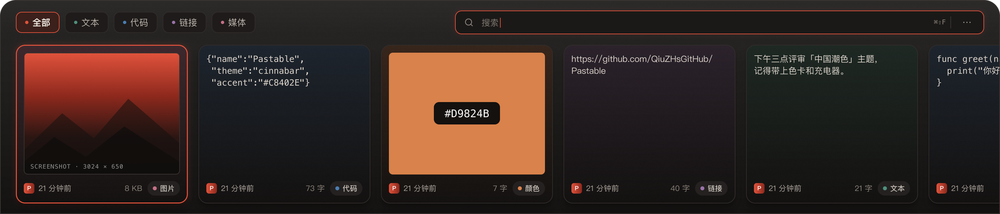
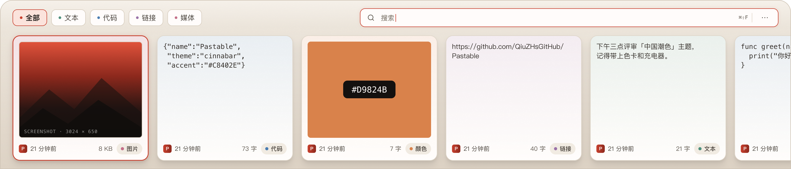

# Theme · 中国潮色 · 朱砂

## Design Specification

1. **Purpose**：底部浮层剪贴板工具，用户会在强光办公环境和夜间桌面之间切换；主题必须跟随 macOS，而不是要求用户再选一次。
2. **Aesthetic Direction**：墨色 / 宣纸 + 朱砂的克制国风。保留原来的不透明分层、细描边和轻阴影，用暖墨替代冷灰、用宣纸替代纯白；朱砂只做强调色，不铺大面积。
3. **Color Palette**：
   - Dark panel `#2C2A29 → #252322 → #141211`
   - Light panel `#F5F0E9 → #EBE4DA → #DDD2C4`
   - Card base dark `#131110` / light `#FFFDFB`
   - Accent dark `#E0523B` / light `#C8402E`
   - Text dark `#F6F1EA / #ACA49B / #8E867D`
   - Text light `#1B1816 / #4A443D / #5C554C`
4. **Typography**：SF Pro（macOS 原生界面字体）、SF Mono（代码/快捷键）。这是平台约束，替换成 Inter 等字体会破坏 macOS 原生感。分类里的紫色仅作为 Link 类型色，不用于渐变。
5. **Layout Strategy**：布局不变；只替换语义 Token。Light 的面板是宣纸色，让白色卡片从背景中浮起来。

## macOS Appearance

- App 默认不设置 `NSApp.appearance`，直接跟随 **macOS 系统 Light / Dark**。
- 不使用 `.preferredColorScheme(.dark)`，也不在设置里放自定义主题选择器。
- 所有组件通过 `@Environment(\.colorScheme)` 读取系统当前外观，`AppTheme` 返回对应的实色 Token。
- 系统切换外观时，面板、设置、更多菜单和空状态一起更新。

## Accent

| Token | Dark | Light |
|---|---|---|
| Accent | `#E0523B` | `#C8402E` |
| Accent soft（选中 Tab 底） | `#3B201B` | `#FBE3DC` |
| Glow alpha（选中卡片） | `0.24` | `0.16` |
| On accent | `#FFFDFB` | `#FFFDFB` |

Dark 提亮到 `#E0523B`，保证在 `#2C2A29` 面板上 ≥ 3:1；Light 用 `#C8402E`，在宣纸底上 4.9:1。朱砂只用于选中描边、聚焦环、搜索光标、Logo 和关键词。

## Solid Text Tokens

文本不使用任何 `white.opacity(...)` / `black.opacity(...)`：

| Token | Dark | Light |
|---|---|---|
| Primary | `#F6F1EA` | `#1B1816` |
| Body | `#DCD5CC` | `#35302B` |
| Secondary | `#ACA49B` | `#4A443D` |
| Tertiary | `#8E867D` | `#5C554C` |
| Placeholder | `#80786F` | `#6E665B` |

阴影、搜索聚焦光晕、选中卡片的朱砂 glow 仍使用 alpha——它们不是文字颜色，透明度在这里是必要的深度信息。

## Surfaces

| Token | Dark | Light |
|---|---|---|
| Panel top / mid / bottom | `#2C2A29` / `#252322` / `#141211` | `#F5F0E9` / `#EBE4DA` / `#DDD2C4` |
| Panel border | `#3A3634` | `#CFC4B5` |
| Card base | `#131110` | `#FFFDFB` |
| Card border | `#302C2A` | `#DED5C8` |
| Search background | `#1B1918` | `#FFFDFB` |
| Tab background | `#1E1B1A` | `#FFFDFB` |
| Selected tab | `#3B201B` | `#FBE3DC` |
| Type pill | `#242120` | `#F1EBE2` |

卡片底色使用分类色与卡片底色的混合：

- Dark：普通 `18%`，选中 `24%`，底色 `#131110`
- Light：普通 `12%`，选中 `20%`，底色 `#FFFDFB`

分类色：Text `#4E8F7C`（晓山青）、Code `#4A7DB2`（青花蓝）、Link `#9A72A8`（木槿紫）、Media `#C46F88`（黛子粉）、Color 使用内容自身 hex，All `#9AA0A6`（烟雨灰）。

## Preview

| Dark | Light |
|---|---|
|  |  |

## Figma

- 中国潮色页面：[Pastable / UI 2026 · 中国潮色](https://www.figma.com/design/4lqk62cQU0WffNMgUXkGez/Paste?node-id=2026-2)
- 中国潮色 Dark 面板：[潮色 / 01 Panel · Dark](https://www.figma.com/design/4lqk62cQU0WffNMgUXkGez/Paste?node-id=2028-528)
- 中国潮色 Light 面板：[潮色 / 01 Panel · Light](https://www.figma.com/design/4lqk62cQU0WffNMgUXkGez/Paste?node-id=2028-628)
- 旧版 Dark 页面：[Pastable / UI 2026](https://www.figma.com/design/4lqk62cQU0WffNMgUXkGez/Paste?node-id=2006-6)
- 旧版 Light 页面：[Pastable / UI 2026 · Light](https://www.figma.com/design/4lqk62cQU0WffNMgUXkGez/Paste?node-id=2011-11)
- Full handoff：[docs/figma.md](figma.md) · [design/theme-cinnabar](../design/theme-cinnabar/README.md)

## Implementation

- `AppTheme`：[`Pastable/Core/ThemeManager.swift`](../Pastable/Core/ThemeManager.swift)
- 品牌 / 分类色常量：[`Pastable/Extensions/Color+Extensions.swift`](../Pastable/Extensions/Color+Extensions.swift)
- 面板背景：[`Pastable/ContentView.swift`](../Pastable/ContentView.swift)
- 卡片：[`Pastable/UI/Components/CardCell.swift`](../Pastable/UI/Components/CardCell.swift)
- 分类 / 搜索 / 空状态 / 菜单：`CategoryFilter.swift`、`SearchBar.swift`、`EmptyStateView.swift`、`MoreMenuView.swift`

## Known Differences

- Figma 的来源图标和图片是占位；App 使用真实 App 图标与剪贴板图片。
- Figma 的 Settings 是 500×380 视觉规格；App 使用原生 macOS 标题栏与 TabView。
- 两边的几何、面板尺寸、卡片尺寸、分类 Tab、搜索框、页脚、选中态与 Token 保持一致。
